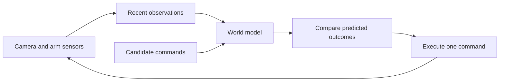

# Small world model for the arm

## Purpose

The model predicts the result of a proposed arm command. The planner uses it to compare small changes to a grasp. All training data and arm tests come from PyBullet.



Read the [work plan](WORLD_MODEL_PLAN.md) and [measured results](../artifacts/world-v1/RESULTS.md). The results state whether the planner helped. A successful training run does not by itself show better control.

## Start a run

Use the same Python environment as the VLA project. No new package is needed.

```bash
uv run --locked python -m tinyvla.world_cli run --root artifacts/world-new
```

You can run each part separately:

```bash
uv run --locked python -m tinyvla.world_cli collect
uv run --locked python -m tinyvla.world_cli train
uv run --locked python -m tinyvla.world_cli predict
uv run --locked python -m tinyvla.world_cli evaluate
uv run --locked python -m tinyvla.world_cli replay
uv run --locked python -m tinyvla.world_cli report
```

The default output folder is `artifacts/world-v1`. Use a new `--root` when you want to keep an earlier training run. Collection resumes from complete episode files. Training replaces model files in that run folder. Evaluation replaces the selected trial logs.

For a collection pilot, use `collect --split train --limit 200`. To collect separate groups, add `--offset`. For development tests, use `evaluate --development --limit 16`. The final tests use different seeds. Keep their results out of training and model selection.

## Recorded data

Each episode stores the following arrays in an NPZ file:

| Array | Contents |
|---|---|
| `images` | 64 × 64 RGB image before the first command and after each command |
| `features` | Visual and sensor inputs for each observation |
| `targets` | Object and sensor labels for training and offline scoring |
| `actions` | Actual x, y, z, finger-opening target, and command duration |
| `times` | Simulator time at each observation |
| `seed` | The scene seed |

Positions and finger opening use meters. Command duration uses seconds. One transition covers a complete servo command. The model receives duration because servo commands do not all take the same time. It does not predict a fixed number of video frames.

The recorder varies contact height and approach error. Some cylinders start on their sides. Some episodes contain explicit gripper commands that drop an object. The recorder saves these commands, so they are known actions in the prediction task. It does not train on unexplained teleports between two records.

The scripted teacher uses object positions to choose training actions. Failed attempts remain in the data. Split seeds keep complete episodes separate. Windows of three observations cannot cross an episode boundary.

## Model inputs and layers

The existing visual CNN is fixed. We resize the 64 × 64 camera image to 128 × 128 for this CNN. Its spatial features retain more shape information than a single object center.

Each observation has 537 input values: 512 spatial features, 14 estimated object and pad coordinates, 7 presence scores, and 4 arm sensor values. Camera calibration maps the estimated image points to the table. Those estimates can be wrong when an object is raised or tipped; the spatial features provide extra information.

A small encoder reads three recent observations and produces 71 learned values. We add 25 direct visual landmark and sensor values to form a 96-value state. A residual readout starts from those measured values and learns corrections. Three recurrent predictors take this state plus a proposed command and duration. Each predicts the next state. The readout estimates object position, orientation, presence in the workspace, a held-object score, and arm sensor values.

Some failed grasps throw objects outside the camera view. The stored data keeps their true poses. For training, we derive a workspace label from x 0.25–0.80 m, y −0.40–0.40 m, and z 0–0.40 m. Position and orientation losses apply only to objects inside that area. The presence loss still applies to all objects. Reports show both workspace pose error and unbounded pose error, so this rule does not erase those failures.

The held-object label means that an object is raised, near the gripper, and the fingers are not fully closed. It is a training label made from simulator state. The deployed model predicts a score for this label. The score is not a calibrated probability.

## Training stages

1. Fit the feature encoder and readout to the simulation labels for 400 updates.
2. Freeze that encoder and train three-step future prediction for 1,200 updates. Save the best validation model as `fixed.pt`.
3. Start from that model. Train the online feature encoder and predictors for 2,400 updates. Update a target encoder slowly after each step. Save the best validation model as `jepa.pt`.

The JEPA loss compares predicted future encodings with target encodings of actual future observations. A variance loss discourages constant learned encodings. The 25 direct values also preserve useful geometry. Object and sensor label losses keep the features useful for control. Model selection uses validation position error within the workspace because the feature space changes during JEPA training.

This is an action-conditioned JEPA-style model with extra simulation labels. The CNN is fixed throughout. The encoder trained in the JEPA phase is the small feature encoder after that CNN. This experiment does not reproduce the large V-JEPA models.

## How planning works

The existing VLA and feedback controller still choose task phases and propose arm commands. The command parser identifies which object the planner must score. It uses the same fixed command vocabulary as the VLA project.

After a failed grasp triggers a retry, the planner considers 25 nearby contact positions at low moves near the selected object. Each candidate contains three commands. The score favors a predicted held object, lift progress, workspace presence, and a small object-to-gripper distance. It penalizes large command changes and disagreement among predictors. A minimum-gain rule can keep the original command. The first grasp attempt uses the existing controller.

The arm executes the first selected command. It then reads a new camera image and its sensors. The next plan uses those observations. Carrying, retries, and stop rules remain part of the existing feedback controller. The planner receives no object poses from the simulator.

## Test design

Prediction tests compare both training stages, shuffled actions, and no-change predictions. The report separates feature error, position error, and actual arm success. It also reports an oracle no-change reference that uses the true current object position. That reference is for offline analysis only.

Arm tests compare matched scene seeds and instructions. The test conditions are normal scenes, tipped objects, a forced slip, a moved object, changed dynamics, and a missing object. Tipped tests rotate all requested objects, including cubes. The per-object summaries separate cylinder results.

Both controllers use the same servo interface. The baseline also records visual features so that timing includes the same observation overhead. Planner time and feature extraction time are reported separately. A forced slip or object move comes from the test harness. The controller receives the resulting observation, not an event label.

## Limits and references

Three observations give short memory. The overhead camera can lose sight of an object. The fixed gripper orientation limits the available grasps. The planner can exploit errors in its own predictions. A better average prediction score does not guarantee a better grasp.

The design draws on [V-JEPA 2](https://github.com/facebookresearch/vjepa2), [JEPA-WMs](https://github.com/facebookresearch/jepa-wms), and [DINO-WM](https://dino-wm.github.io/). Their pretrained weights are not used. The only reused network is the small VLA already trained in this project.
